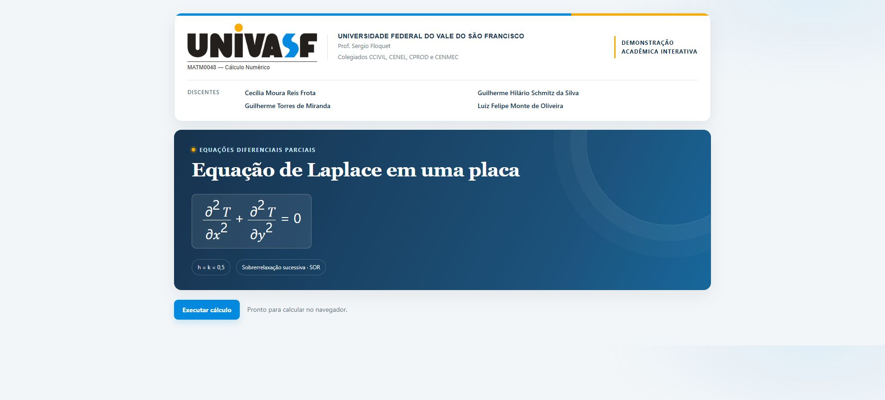

# Equação de Laplace — Cálculo Numérico · UNIVASF

Aplicação acadêmica para calcular e visualizar a distribuição estacionária de temperatura em uma placa retangular. A solução utiliza diferenças finitas e o método de sobrerrelaxação sucessiva (SOR), implementados em JavaScript sem bibliotecas externas.



## Como abrir

1. Baixe o projeto pelo botão **Code → Download ZIP** do GitHub e extraia os arquivos.
2. Abra `index.html` em um navegador.
3. Clique em **Executar cálculo**.

A página funciona localmente, sem instalação de pacotes, servidor ou conexão com a internet.

## Recursos

- Indicadores da malha, convergência, erros e tempo de execução.
- Superfície tridimensional e mapa de temperatura.
- Animação das varreduras SOR.
- Planta interativa com os 6.399 pontos da malha: seleção por clique ou pelas setas do teclado.
- Caixa junto ao ponto selecionado com coordenadas, temperatura numérica, temperatura analítica e erro absoluto.
- Lista dos 6.083 pontos internos e exportação em CSV.
- Código do método disponível na própria página.

## Problema e método

Em regime estacionário, as temperaturas deixam de variar no tempo. Sem fontes de calor no interior, a equação de Laplace relaciona cada ponto aos seus vizinhos. As quatro bordas têm valores prescritos; o algoritmo calcula os pontos internos.

Resolve-se a equação de Laplace no domínio $1<x<40$, $0<y<40$:

$$
\frac{\partial^2 T}{\partial x^2}+\frac{\partial^2 T}{\partial y^2}=0.
$$

As condições de contorno utilizadas são:

$$
T(1,y)=\ln(1+y^2),\qquad T(40,y)=\ln(1600+y^2),
$$

$$
T(x,0)=2\ln x,\qquad T(x,40)=\ln(x^2+1600).
$$

Com $h=k=0{,}5$, o esquema de cinco pontos resulta em:

$$
4T_{i,j}-T_{i-1,j}-T_{i+1,j}-T_{i,j-1}-T_{i,j+1}=0.
$$

O sistema tem 6.083 incógnitas internas. Os 316 pontos de borda recebem os valores prescritos. As estimativas internas começam em zero e são atualizadas por SOR com ordenação em duas cores, fator $\omega=1{,}92$ e tolerância de $10^{-12}$ para a maior alteração por varredura. O limite de execução é de 20.000 varreduras.

A referência analítica é $T(x,y)=\ln(x^2+y^2)$. Os erros são calculados sobre os pontos internos. A animação acompanha as iterações numéricas; a equação modela o estado estacionário.

Os valores de $T$ são apresentados sem unidade física: o enunciado fornece funções de contorno, mas não estabelece graus Celsius ou outra unidade. No mapa, os tons mais escuros representam os valores maiores.

## Resultados de referência

| Medida | Valor |
| --- | ---: |
| Pontos da malha | 79 × 81 = 6.399 |
| Pontos internos calculados | 6.083 |
| Varreduras SOR | 479 |
| Erro absoluto máximo | 0,004402389 |
| Ponto de erro máximo | (1,5; 1,5) |
| Erro absoluto médio | 0,000135291 |
| RMSE | 0,000318676 |

O tempo de execução é medido a cada cálculo e depende do computador e do navegador.

## Executar o JavaScript no console do navegador

1. Abra `index.html` no navegador.
2. Abra o arquivo [solve_laplace.js](solve_laplace.js), copie todo o conteúdo e cole no **Console** das ferramentas do navegador (F12).
3. Pressione **Enter**. O cálculo é executado e as 6.083 temperaturas internas são impressas no console.

O arquivo é autocontido e pode ser colado no console de qualquer página. Ao executar o código novamente, ele refaz o cálculo. Na página do aplicativo, `solveLaplace().metrics` também mostra as métricas sem imprimir a lista completa.

Se Node.js já estiver instalado, o mesmo algoritmo pode ser executado no terminal:

```sh
node solve_laplace.js
```

```text
index.html           Aplicação pronta para abrir
solve_laplace.js     Algoritmo puro, executável no console
univasf.png          Marca institucional
app_screenshot.png   Captura real da aplicação
campus_petrolina.jpg Fotografia do campus
```

## Discentes

- Cecília Moura Reis Frota
- Guilherme Hilário Schmitz da Silva
- Guilherme Torres de Miranda
- Luiz Felipe Monte de Oliveira

Disciplina: **MATM0048 — Cálculo Numérico**. Professor: **Sergio Floquet**. Universidade Federal do Vale do São Francisco — **UNIVASF**.

A identidade visual utiliza a marca institucional e o [manual de identidade visual da UNIVASF](https://portais.univasf.edu.br/comunicacao/ManualdeIdentidadeVisualUniversidadeFederaldoValedoSoFranciscoUnivasf.pdf).

### Imagem da universidade


Campus Petrolina. Fotografia de [A. Júnior, disponibilizada no Wikimedia Commons](https://commons.wikimedia.org/wiki/File:UNIVASF_-_Universidade_Federal_do_Vale_do_S%C3%A3o_Francisco_-_Petrolina,_Pernambuco.jpg), sob a licença [CC BY 2.0](https://creativecommons.org/licenses/by/2.0/). A imagem não foi alterada.
